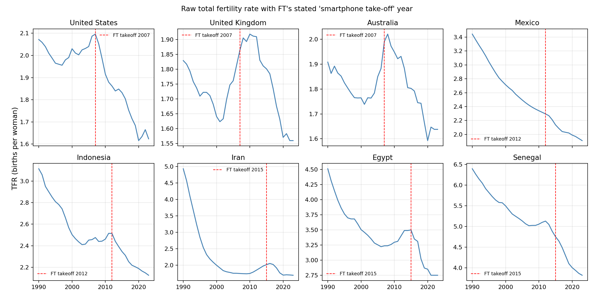
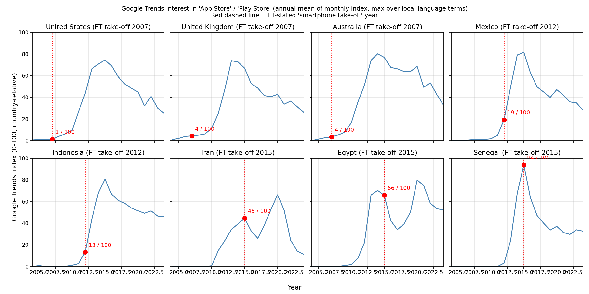

# ft-fertility-replication

A short audit of the chart in John Burn-Murdoch, "Why birth rates are falling
everywhere all at once," *Financial Times*, 16 May 2026.

The chart is titled "% change in total fertility rate relative to pre-smartphone
trend, by years before/since smartphones." Eight countries are aligned at a
"smartphone take-off" year on the x-axis. The footnote reads: *"Smartphone
take-off based on surveys of smartphone adoption and Google searches for app
stores."*

This repository documents two checks against that footnote, using the FT's
named country-level take-off years (United States, United Kingdom and
Australia: 2007; Mexico and Indonesia: 2012; Iran, Egypt and Senegal: 2015).

## 1. The raw fertility series

The first check: plot the underlying total fertility rate for each country
(UN World Population Prospects 2024) with the FT-stated take-off year
overlaid as a dashed red line.



Several of the FT take-off years do not coincide with visible inflections in
the TFR series. Iran's TFR had already collapsed from ~5 to ~2 between 1990
and 2000; the 2015 marker lands after a decade-long policy-driven plateau.
Egypt's TFR rose between 2005 and 2014, then resumed falling around the time
of the 2013-14 political transition. The UK and Australian TFRs peaked
around 2008-10, not 2007. The 2007 US, UK and Australian markers coincide
with the iPhone's launch year, not with majority smartphone ownership.

## 2. Google Trends interest in "App Store" / "Play Store"

The second check uses the FT's other stated data source. Annual mean of the
Google Trends index for "App Store" / "Google Play" / "Play Store" (with
local-language variants where relevant), 2004-2024, in each of the eight
countries, with the FT take-off year marked.



In 2007 the Google Trends index for these search terms stood at 1/100 in the
United States and 4/100 in the United Kingdom and Australia. For five of the
eight countries the index did not cross 50/100 until four to six years after
the FT-stated take-off.

## 3. Smartphone ownership at the FT-stated take-off year

The third check is survey-based. Smartphone ownership (% of adults) in each
country in its FT take-off year, from Pew Research Center, ACMA/Deloitte and
ISPA (sources listed in `scripts/05_adoption_table.py`).

| Country | FT take-off year | Smartphone ownership in that year |
|---|---|---|
| United States | 2007 | ~0% |
| United Kingdom | 2007 | ~0% |
| Australia | 2007 | ~0% |
| Mexico | 2012 | ~10-15% |
| Indonesia | 2012 | ~10% |
| Iran | 2015 | ~36% |
| Egypt | 2015 | ~28% |
| Senegal | 2015 | ~19% |

The implicit "take-off" threshold ranges from effectively zero to roughly a
third of the adult population. The two stated methodologies (adoption surveys
and Google Trends) do not produce these dates.

## Reproducing

```bash
pip install pandas matplotlib numpy pytrends
python scripts/01_download_tfr.py
python scripts/02_plot_raw_fertility.py
python scripts/03_download_google_trends.py
python scripts/04_plot_google_trends.py
python scripts/05_adoption_table.py
```

The UN WPP download is ~16 MB; the Google Trends pull takes about a minute
and is subject to Google's rate limits.

## Sources

- Total fertility rate: UN World Population Prospects 2024, medium variant,
  Country/Area level, observed 1950-2023.
- Google Trends: trends.google.com, country-restricted queries.
- Smartphone ownership: Pew Research Center Global Attitudes Survey, Pew
  Mobile Fact Sheet, ACMA Communications Report, Deloitte Mobile Consumer
  Survey, ISPA / Statista.

## Licence

MIT.
